# Actividad #1 - Manejo de Docker Compose

## 📄 **INFORME DE LABORATORIO**

**Estudiante:** Shadith Cuenca
**Fecha:** 17 de Noviembre de 2025
**Materia:** DevOps
**Universidad:** Jala University

---

## 🎯 **Objetivo del Laboratorio**

Aprender a gestionar aplicaciones multicontenedor de manera declarativa usando Docker Compose, permitiendo versionar las configuraciones y simplificar la replicabilidad de entornos mediante el uso de redes Docker.

---

## 📋 **Descripción de la Actividad**

### **Requisitos Implementados:**

1. ✅ **Crear compose.yml** para Backend + Base de datos a partir de comandos Docker Run
2. ✅ **Configurar persistencia de datos** con volumes y red propia "back-end"
3. ✅ **Generar certificado SSL self-signed** usando IP local como DOMAIN
4. ✅ **Crear compose file para Frontend** con load balancer Nginx y red "front-end"
5. ✅ **Configurar Nginx con SSL** mediante bind mounts para certificados y configuración

---

## 🏗️ **Arquitectura Implementada**

```mermaid
graph TB
    subgraph "Red front-end (172.23.0.0/16)"
        LB[Nginx Load Balancer<br/>Port: 8080/8443]
        FE[Frontend Vite<br/>Port: 80]
    end

    subgraph "Red back-end (172.22.0.0/16)"
        BE[Backend Node.js<br/>Port: 3000]
        DB[PostgreSQL 15<br/>Port: 5432]
    end

    subgraph "Host"
        CRT[Certificados SSL<br/>./certs/]
        NGX[nginx.conf<br/>./nginx/]
        VOL[Volume Persistente<br/>db_data]
    end

    LB --> FE
    LB --> BE
    BE --> DB

    LB -.-> CRT
    LB -.-> NGX
    DB -.-> VOL
```



---

## 📁 **Estructura del Proyecto**

```
DevOps-Docker/
├── 📄 compose.yml                 # Backend + Base de datos
├── 📄 docker-compose.frontend.yml # Frontend + Load Balancer
├── 📁 backend/
│   ├── 📄 Dockerfile
│   ├── 📄 package.json
│   └── 📁 src/
├── 📁 frontend/
│   ├── 📄 Dockerfile
│   └── 📄 package.json
├── 📁 nginx/
│   └── 📄 nginx.conf             # Configuración Nginx con SSL
├── 📁 certs/
│   ├── 📄 server.crt             # Certificado SSL
│   └── 📄 server.key             # Llave privada SSL
└── 📄 lab3.md                    # Este informe
```

---

## 🔧 **Implementación Detallada**

### **Paso 1: Crear archivo compose.yml para backend con base de datos**

✅ **ARCHIVO:** `compose.yml`

**Servicios configurados:**
- **PostgreSQL 15**: Base de datos con variables de entorno
- **Backend Node.js**: Aplicación con health checks y dependencias
- **Volume persistente**: `db_data` para persistencia
- **Red aislada**: `back-end` (172.22.0.0/16)

### **Paso 2: Configurar persistencia de datos y red back-end**

✅ **CONFIGURACIÓN:**
```yaml
volumes:
  db_data:
    driver: local

networks:
  back-end:
    driver: bridge
    ipam:
      config:
        - subnet: 172.22.0.0/16
```

### **Paso 3: Crear certificado SSL self-signed**

✅ **COMANDO EJECUTADO:**
```bash
openssl req -x509 -nodes -days 365 -newkey rsa:2048 \
  -keyout certs/server.key \
  -out certs/server.crt \
  -subj "/C=BO/ST=SC/L=Cochabamba/O=DevOps/CN=192.168.1.106"
```

**Datos del certificado:**
- **País:** Bolivia (BO)
- **Estado:** Santa Cruz (SC)
- **Ciudad:** Cochabamba
- **Organización:** DevOps
- **Dominio:** 192.168.1.106 (IP local)

### **Paso 4: Crear compose file para frontend con load balancer**

✅ **ARCHIVO:** `docker-compose.frontend.yml`

**Servicios configurados:**
- **Frontend Vite**: Aplicación web compilada con Nginx
- **Load Balancer Nginx**: Proxy reverso con SSL/TLS
- **Red aislada**: `front-end` (172.23.0.0/16)
- **Conexión externa**: a red `back-end` para acceso al API

### **Paso 5: Configurar Nginx con SSL y bind mounts**

✅ **ARCHIVO:** `nginx/nginx.conf`

**Configuración implementada:**
- **Servidor HTTP**: Puerto 80 con proxy a frontend/backend
- **Servidor HTTPS**: Puerto 443 con certificados SSL
- **Bind mounts**:
  - `./certs:/etc/nginx/certs` (certificados SSL)
  - `./nginx/nginx.conf:/etc/nginx/nginx.conf` (configuración)

---

## 🌐 **URLs de Acceso**

| Servicio | Protocolo | URL | Puerto |
|----------|-----------|-----|---------|
| Frontend | HTTP | http://localhost:8080/ | 8080 |
| Frontend | HTTPS | https://localhost:8443/ | 8443 |
| API Backend | HTTP | http://localhost:8080/api/ | 8080 |
| Backend Directo | HTTP | http://localhost:3000/ | 3000 |
| Base de Datos | PostgreSQL | localhost:5432 | 5432 |

---

## 🧪 **Pruebas y Validación**

### **Resultados de las Pruebas:**

1. **✅ Contenedores Levantados:**
   - `qatu-db`: Base de datos PostgreSQL healthy
   - `qatu-backend`: API Node.js operativa
   - `qatu-frontend`: Aplicación web compilada
   - `qatu-lb`: Load balancer Nginx con SSL

2. **✅ Conectividad HTTP:**
   ```bash
   curl -I http://localhost:8080/
   # Resultado: HTTP/1.1 200 OK
   ```

3. **✅ API Backend Funcional:**
   ```bash
   curl http://localhost:8080/api/
   # Resultado: {"name":"QATU API","version":"1.0.0"}
   ```

4. **✅ Conectividad HTTPS:**
   ```bash
   curl -k -I https://localhost:8443/
   # Resultado: HTTP/1.1 200 OK
   ```

5. **✅ Persistencia de Datos:**
   - Volume `db_data` creado y montado
   - Base de datos PostgreSQL healthy

6. **✅ Redes Docker Configuradas:**
   - `devops-docker_back-end`: Comunicación backend ↔ DB
   - `devops-docker_front-end`: Comunicación frontend ↔ LB
   - Conexión entre redes para acceso al API

---

## 📋 **Archivos Creados y su Propósito**

| Archivo | Propósito | Estado | Descripción |
|---------|-----------|---------|-------------|
| `compose.yml` | Backend + Base de datos | ✅ Funcional | Servicios backend y PostgreSQL con persistencia |
| `docker-compose.frontend.yml` | Frontend + Load Balancer | ✅ Funcional | Servicios frontend y Nginx con SSL |
| `nginx/nginx.conf` | Configuración Nginx | ✅ Funcional | Proxy reverso con HTTP/HTTPS y SSL |
| `certs/server.crt` | Certificado SSL | ✅ Creado | Certificado público para HTTPS |
| `certs/server.key` | Llave SSL privada | ✅ Creado | Llave privada del certificado SSL |

---

## 🔍 **Comandos para Verificación (Evidencias)**

### **Validación de Configuraciones:**
```bash
# Validar configuración backend
docker-compose -f compose.yml config

# Validar configuración frontend
docker-compose -f docker-compose.frontend.yml config
```

### **Verificación de Certificados:**
```bash
# Ver archivos de certificado
ls -la certs/

# Verificar contenido del certificado
openssl x509 -in certs/server.crt -text -noout | grep -A 2 "Subject:"

# Verificar fecha de expiración
openssl x509 -in certs/server.crt -noout -dates
```

### **Estado de los Servicios:**
```bash
# Ver todos los contenedores
docker ps --format "table {{.Names}}\t{{.Status}}\t{{.Ports}}"

# Verificar redes
docker network ls

# Verificar volumes
docker volume ls
```

### **Pruebas de Conectividad:**
```bash
# Probar frontend vía load balancer
curl -I http://localhost:8080/

# Probar API vía load balancer
curl http://localhost:8080/api/

# Probar HTTPS
curl -k -I https://localhost:8443/

# Verificar conectividad entre contenedores
docker exec qatu-lb ping -c 2 frontend
docker exec qatu-backend ping -c 2 db
```

---

## 🛠️ **Comandos de Gestión**

### **Levantar Servicios:**
```bash
# Backend + Base de datos
docker-compose -f compose.yml up -d

# Frontend + Load Balancer
docker-compose -f docker-compose.frontend.yml up -d
```

### **Detener Servicios:**
```bash
# Detener backend
docker-compose -f compose.yml down

# Detener frontend
docker-compose -f docker-compose.frontend.yml down

# Limpiar completamente
docker stop qatu-backend qatu-db qatu-frontend qatu-lb 2>/dev/null || true
docker rm qatu-backend qatu-db qatu-frontend qatu-lb 2>/dev/null || true
```

---

## 🎓 **Aprendizajes Adquiridos**

### **Conceptos Implementados:**

1. **🏗️ Multi-contenedor:** Coordinación de múltiples servicios
2. **🔐 SSL/TLS:** Implementación de HTTPS con certificados self-signed
3. **🌐 Redes Docker:** Aislamiento y comunicación entre servicios
4. **💾 Persistencia:** Volumes para datos persistentes
5. **⚖️ Load Balancing:** Nginx como proxy reverso
6. **🔄 Declarativo:** Configuración versionable y replicable
7. **🔧 Bind Mounts:** Configuración externa montada en contenedores

### **Beneficios de Docker Compose:**

- **✅ Replicabilidad:** Mismo entorno en cualquier lugar
- **✅ Versionamiento:** Configuración en código fuente
- **✅ Escalabilidad:** Fácil escalado de servicios
- **✅ Aislamiento:** Redes y volúmenes dedicados
- **✅ Orquestación:** Gestión simplificada de múltiples contenedores

---

## ✅ **Conclusión**

El laboratorio se completó exitosamente implementando una arquitectura completa multicontenedor con las siguientes características:

- **🎯 Objetivo Cumplido:** Gestión declarativa de aplicaciones multicontenedor
- **🏗️ Arquitectura Robusta:** Backend + Frontend + Load Balancer + Base de datos
- **🔐 Seguridad Implementada:** HTTPS con certificados SSL válidos
- **💾 Persistencia Asegurada:** Volumes para datos persistentes
- **🌐 Comunicación Segura:** Redes Docker aisladas y conectadas
- **⚙️ Configuración Versionable:** Archivos YAML listos para producción

La implementación demuestra cómo Docker Compose simplifica la orquestación de aplicaciones complejas, permitiendo replicar entornos de desarrollo y producción de manera consistente y versionable.

---

## 📊 **Resumen Ejecutivo**

| Componente | Tecnología | Estado | Función |
|------------|------------|---------|---------|
| **Backend** | Node.js + Express | ✅ Operativo | API REST |
| **Frontend** | Vite + Nginx | ✅ Operativo | Aplicación web |
| **Load Balancer** | Nginx + SSL | ✅ Operativo | Proxy reverso |
| **Base de Datos** | PostgreSQL 15 | ✅ Operativa | Persistencia |
| **Redes** | Docker Networks | ✅ Configuradas | Aislamiento |
| **Certificados** | Self-signed SSL | ✅ Válidos | HTTPS |

